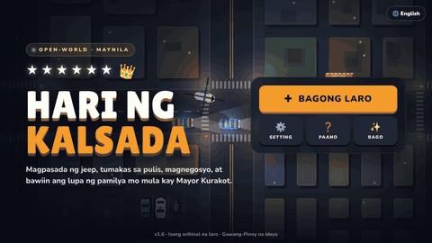

# 👑 HARI NG KALSADA: Maynila — v1.9

An original top-down open-world action/driving game set in a Manila-inspired city. Steal jeepneys,
escape a **6-star wanted system**, change your look so cops can't recognise you, and take down the
corrupt Mayor Kurakot.

🌐 **Filipino & English** · 📲 **Installable & works offline** · 📱 **Phone & PC**

Runs in any modern browser on **phone or PC**. There's no install and no build step.

## ▶️ How to play
* **Easiest:** open `index.html` in Chrome, Edge, Firefox or Safari.
* **On your phone:** turn on GitHub Pages (repo → Settings → Pages → Deploy from branch →
  this branch, root `/`), then open the Pages link on your phone. You can also "Add to Home Screen".
* Or run a local server: `python3 -m http.server` and open `http://localhost:8000`.

## 📲 Install it like an app
Open the game link on your phone and tap **📲 I-INSTALL ANG APP** on the home page (Android/Chrome), or **Share → Add to Home Screen** (iPhone). It opens fullscreen and works without internet. Back up your saves anytime: ☰ → I-SAVE → **📤 I-EXPORT**.

## 🦅 Chapter 4: Dabaw (v1.9)
Fly to **Dabaw**: Bundok Apo, the Eagle Center and a banana plantation. 6 missions against the illegal-logging boss **Ninong**, plus a brand-new pan-and-zoom map.

## 🏝 Chapter 3: Sugbo (v1.8)
Fly from the Manila Airport (or take the ferry from San Isidro) to **Sugbo**, a Visayan port city. 8 missions against the smuggling king **Kapitan Tiburon**, choices that carry over from Chapter 2, and **4 final endings**.

## 🔫 Guns, typhoons & fiestas (v1.7)
* **Guns** at **🔫 Armas ni Kabo**: pistol, shotgun, SMG, rifle, grenades and a bulletproof vest. Aim with the mouse on PC (auto-aim on touch) and do **drive-bys**. Clear 3 **☠️ gang hideouts**.
* **5 new vehicles** (ambulance, fire truck, garbage truck, padyak, pickup) and jobs: **Paramedic, Bumbero, Basurero**.
* **Typhoons** with wind, flying debris and citywide floods, plus a **Rescue** job. The **Tondo fiesta parade**, **parols** in the "ber" months and **Undas** candles.
* Mini-games: **Videoke**, **3-Point Shootout** and a **shooting range**. A **wardrobe** with accessories, and **Photo Mode**.

## 🌾 Chapter 2: Probinsya (v1.5)
After the Manila story, drive the highway east to **San Isidro** and help Lola Isyang against the land-grabbing **Don Severo**. 6 missions, a stealth mission, and a **choice with two endings**.

## 🧭 Easy driving (default)
Point where you want to go (arrow keys / WASD or the joystick) and the car steers itself. If there's no road that way, it keeps straight and turns at the next intersection. It also brakes before walls. Switch to **Classic** (gas/brake/steer) in ⚙️ Settings.

## 🎮 Controls
| | Keyboard | Touch |
|---|---|---|
| Walk / drive | WASD / Arrows | Left joystick (in a car, point where you want to go; point backwards to reverse) |
| Run | Shift | Push the joystick all the way |
| Enter / exit / use shop | E or F | **SAKAY / BABA / GAMIT** |
| Punch / handbrake | Space | **SUNTOK / PRENO** |
| Aim / shoot / reload | Mouse / Click or X / G | **BARIL** (auto-aim), **🔫** in a car |
| Photo mode | O | ☰ → 📷 |
| Horn / siren | H | **BUSINA** |
| Switch weapon | Q | **🔄** |
| Start/stop side job | J | **💼** |
| Change radio station | R | **📻** |
| Map / Pause | M / Esc | 🗺 / ☰ |

## ⭐ The wanted system
* Only crimes that are **seen** count, either by a cop or by one of the **CCTV cameras** at intersections.
* Police build a **SUSPECT profile** from 4 clues: **CCTV · clothes · face · car**.
* **White stars** mean you're being chased. **Outlined stars** mean they lost you and are searching a
  purple **search zone**. **Red stars** mean you got out of the zone and are being forgotten.
* Change clothes at the **Ukay-Ukay**, get a haircut at the **Barberya**, repaint at **Pintura**, or just
  switch cars. If a cop spots you and nothing matches the profile, they ignore you.
* 1★ patrols → 3★ roadblocks → 4★ SWAT → 5★ helicopter + spike strips → 6★ army trucks.

## 💼 Business, jobs & saving (v1.3)
* **Save anytime**: ☰ → I-SAVE (3 slots) or just leave. The Auto-save remembers where you were, your car and your mission.
* **Weapons** (Hardware): pamalo, tirador, water gun. **Properties** with daily income. A **garage** and **car upgrades**.
* **Side jobs**: Food Rider, Taxi, Tow Truck, Vigilante, Underground Race. **20 achievements** and % completion.

## 🌆 A living city (v1.2)
* **Day and night** on a 12-minute cycle, **rain** with lightning, **floods** on some streets, **traffic lights** and **rush hour**.
* Street life: **taho** vendors in the morning, **balut** at night, kids at **basketball courts**, devotees at **Quiapo**, **traffic enforcers**.
* **Isla Maligaya**: an island in Manila Bay. Take the **ferry** (₱50) or drive a **bangka**. Watch out for **police boats**.

## 🎵 Music & radio
All music is synthesized live in the browser; there are no audio files.
* **HIMIG FM 98.7**: OPM pop ballad · **BUDOTS 101.1**: budots dance · **KALYE RAP 89.5**: Pinoy boom-bap with kulintang gongs
* DJ lines and fake ads scroll on screen while you drive. Each car starts on its own station (jeepneys love budots).
* A title theme, a lo-fi track while walking, and **chase music** that adds layers as your stars go up.

## ⚙️ Settings
Music and SFX volume · walking music on/off · difficulty (**Madali / Normal / Mahirap**) · graphics (Maganda / Mabilis for older phones) ·
joystick size · left-handed controls · tutorial tips on/off.

## 📖 Story missions (Chapter 1)
1. **Bagong Salta**: arrive in Manila and drive Tito Boy's jeepney
2. **Hiram Muna**: steal a red SUV for Mang Ben's talyer
3. **Mainit Pa!**: deliver a lechon to the Tondo fiesta before it gets cold
4. **Bagong Itsura**: CCTV caught you; change your look and escape
5. **Karera sa Baywalk**: street race across the city
6. **Singilan**: chase down and ram a debtor's van
7. **Buntot**: tail the Mayor's black SUV to his secret bodega
8. **Hari ng Kalsada**: steal the armored van full of stolen money and escape 6 stars

Failed a mission? Tap **ULITIN** within 20 seconds to restart from the checkpoint, with no repeated dialogue.

Side activities: jeepney **pasada**, selling cars to Mang Ben, and **20 Gintong Tsinelas** to collect.

See **[CHANGELOG.md](CHANGELOG.md)** for what changed in each version, and **[DESIGN.md](DESIGN.md)** for the full design document: research, game flow, districts, systems.

## 🗂 Code
| File | What |
|---|---|
| `js/map.js` | Procedural city, chunked rendering, path-finding flow fields |
| `js/vehicles.js` | 22 vehicle types, arcade physics, damage, drawing |
| `js/people.js` | Pedestrians, cops on foot, player |
| `js/traffic.js` | Lane-following traffic AI, spawning |
| `js/police.js` | 6-star wanted system, suspect profile, cop AI, helicopter, roadblocks |
| `js/missions.js` | Story missions (chapters 1–2), shops, pasada |
| `js/chapter3.js` | Chapter 3 missions and the final endings |
| `js/chapter4.js` | Chapter 4 missions and the epilogue |
| `js/mapview.js` | Interactive full-screen map |
| `js/ui.js` | HUD, minimap, map, dialogue, menus, touch controls |
| `js/game.js` | Main loop, collisions, camera, lighting, save/load |
| `js/audio.js` | Synthesized sound effects (WebAudio) |
| `js/music.js` | Music engine: 6 songs, radio stations, DJ lines |
| `js/settings.js` | Settings, difficulty, tutorial tips |
| `js/save.js` | Save slots, autosave, load |
| `js/weapons.js` | Melee weapons, projectiles, hardware shop |
| `js/guns.js` | Guns, grenades, armor, gun shop, gang hideouts, shooting range |
| `js/events.js` | Typhoons + rescue job, fiesta parade, Pasko, Undas |
| `js/minigames.js` | Videoke and 3-point shootout |
| `js/wardrobe.js` | Wardrobe/accessories and photo mode |
| `js/economy.js` | Properties, garage, car customization, achievements |
| `js/jobs.js` | Side jobs: rider, taxi, tow, vigilante, race, paramedic, bumbero, basurero |
| `js/i18n.js`, `js/lang_en.js` | English language option |
| `js/portraits.js` | Character portraits |
| `js/pwa.js`, `sw.js`, `manifest.json` | Installable offline app |
| `js/tutorial.js` | New-player tutorial, developer mode |
| `js/world.js` | Day/night, weather, floods, traffic lights, street life, police boats |

## 🚀 Publishing
See **[ITCH.md](ITCH.md)** for the itch.io guide, store text and release checklist.
