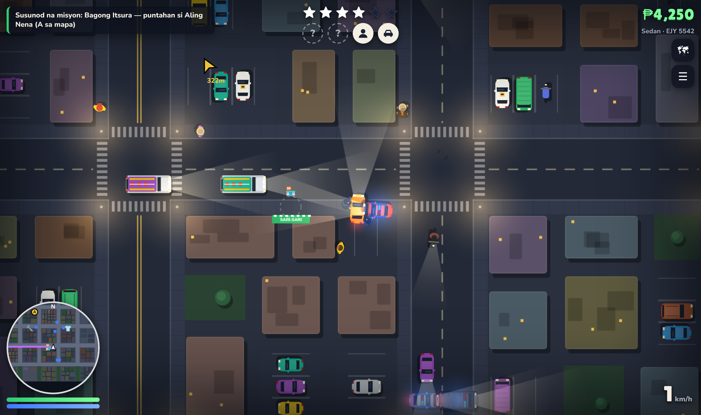

# 👑 HARI NG KALSADA: Maynila

An original top-down open-world action/driving game set in a Manila-inspired city. Steal jeepneys,
escape a **6-star wanted system**, change your look so cops can't recognise you, and take down the
corrupt Mayor Kurakot.

Runs in any modern browser on **phone or PC**. There's no install and no build step.

## ▶️ How to play
* **Easiest:** open `index.html` in Chrome, Edge, Firefox or Safari.
* **On your phone:** turn on GitHub Pages (repo → Settings → Pages → Deploy from branch →
  this branch, root `/`), then open the Pages link on your phone. You can also "Add to Home Screen".
* Or run a local server: `python3 -m http.server` and open `http://localhost:8000`.

## 🎮 Controls
| | Keyboard | Touch |
|---|---|---|
| Walk / drive | WASD / Arrows | Left joystick (in a car, point where you want to go; point backwards to reverse) |
| Run | Shift | Push the joystick all the way |
| Enter / exit / use shop | E or F | **SAKAY / BABA / GAMIT** |
| Punch / handbrake | Space | **SUNTOK / PRENO** |
| Horn | H | **BUSINA** |
| Change radio station | R | **📻** |
| Map / Pause | M / Esc | 🗺 / ☰ |

## ⭐ The wanted system
* Only crimes that are **seen** count, either by a cop or by one of the **CCTV cameras** at intersections.
* Police build a **SUSPECT profile** from 4 clues: **CCTV · clothes · face · car**.
* **White stars** mean you're being chased. **Outlined stars** mean they lost you and are searching a
  purple **search zone**. **Red stars** mean you got out of the zone and are being forgotten.
* Change clothes at the **Ukay-Ukay**, get a haircut at the **Barberya**, repaint at **Pintura**, or just
  switch cars. If a cop spots you and nothing matches the profile, they ignore you.
* 1★ patrols → 3★ roadblocks → 4★ SWAT → 5★ helicopter + spike strips → 6★ army trucks.

## 🎵 Music & radio
All music is synthesized live in the browser; there are no audio files.
* **HIMIG FM 98.7**: OPM pop ballad · **BUDOTS 101.1**: budots dance · **KALYE RAP 89.5**: Pinoy boom-bap with kulintang gongs
* DJ lines and fake ads scroll on screen while you drive. Each car starts on its own station (jeepneys love budots).
* A title theme, a lo-fi track while walking, and **chase music** that adds layers as your stars go up.

## ⚙️ Settings
Music and SFX volume · walking music on/off · difficulty (**Madali / Normal / Mahirap**) · graphics (Maganda / Mabilis for older phones) ·
joystick size · left-handed controls · tutorial tips on/off.

## 📖 Story missions
1. **Bagong Salta**: arrive in Manila and drive Tito Boy's jeepney
2. **Hiram Muna**: steal a red SUV for Mang Ben's talyer
3. **Mainit Pa!**: deliver a lechon to the Tondo fiesta before it gets cold
4. **Bagong Itsura**: CCTV caught you; change your look and escape
5. **Karera sa Baywalk**: street race across the city
6. **Singilan**: chase down and ram a debtor's van
7. **Buntot**: tail the Mayor's black SUV to his secret bodega
8. **Hari ng Kalsada**: steal the armored van full of stolen money and escape 6 stars

Failed a mission? Tap **ULITIN** within 20 seconds to restart from the checkpoint, with no repeated dialogue.

Side activities: jeepney **pasada**, selling cars to Mang Ben, and **20 Gintong Tsinelas** to collect.

See **[DESIGN.md](DESIGN.md)** for the full design document: research, game flow, districts, systems.

## 🗂 Code
| File | What |
|---|---|
| `js/map.js` | Procedural city, chunked rendering, path-finding flow fields |
| `js/vehicles.js` | 16 vehicle types, arcade physics, damage, drawing |
| `js/people.js` | Pedestrians, cops on foot, player |
| `js/traffic.js` | Lane-following traffic AI, spawning |
| `js/police.js` | 6-star wanted system, suspect profile, cop AI, helicopter, roadblocks |
| `js/missions.js` | Story missions, shops, pasada |
| `js/ui.js` | HUD, minimap, map, dialogue, menus, touch controls |
| `js/game.js` | Main loop, collisions, camera, lighting, save/load |
| `js/audio.js` | Synthesized sound effects (WebAudio) |
| `js/music.js` | Music engine: 6 songs, radio stations, DJ lines |
| `js/settings.js` | Settings, difficulty, tutorial tips |
